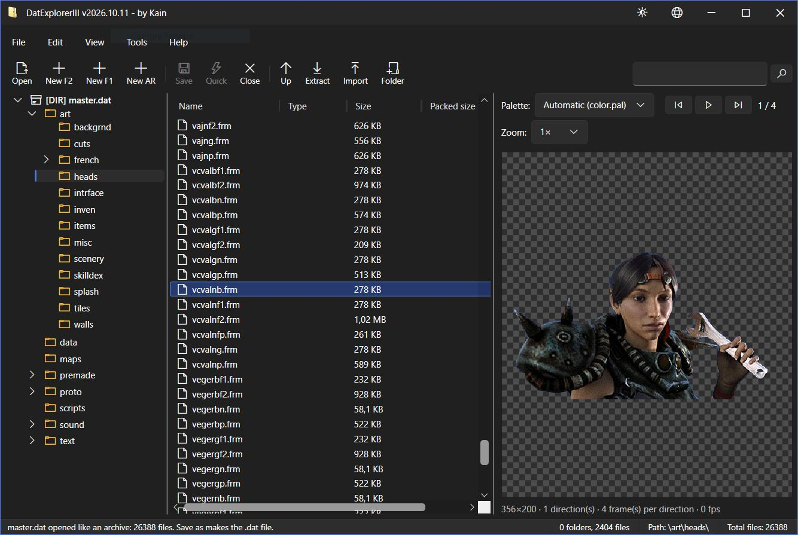
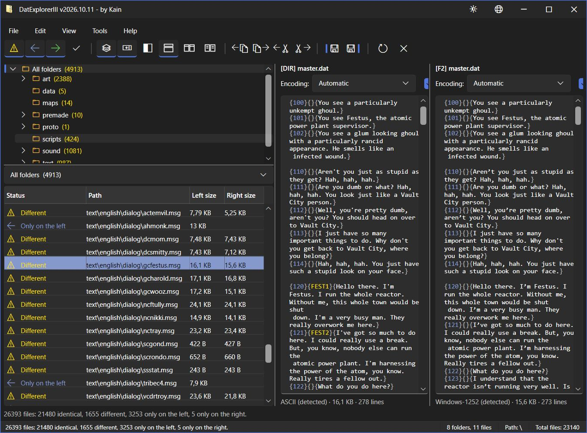
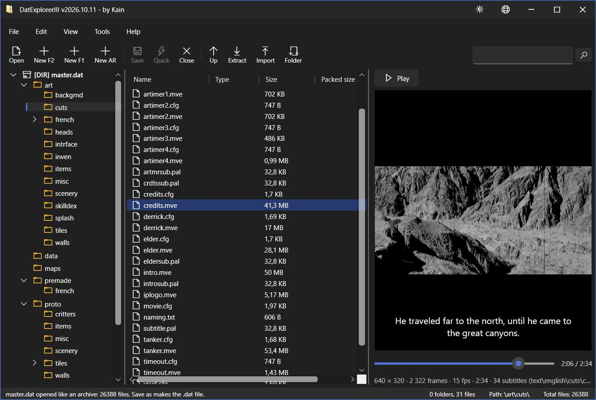
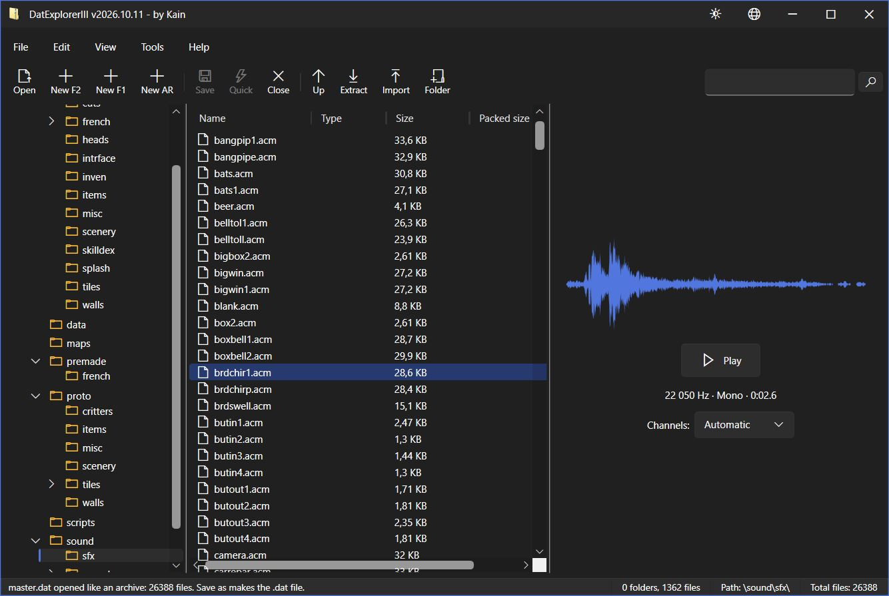

# DatExplorerIII (by Kain)

DAT archive explorer for Fallout 1, Fallout 2 and Arcanum: browse, extract, import, rename, delete and repack files.

A rewrite in **.NET 10 / WPF (Fluent theme)** of *DAT Explorer II* by Mr.STALIN, which itself replaced DatExpl 1.43 by Dims.



## Features

- **Comparison of two DATs** (*Tools* menu, files and/or folders): state of each file (identical, different, only on the left or on the right), filters, a preview of the two versions side by side, copy or move of the selected files to the left or to the right, then saving of each side. What the comparison ignores is set in *Tools > Settings > Comparison*: white space characters, blank lines, case, line endings (Windows/Unix/Mac), code page, numbers, comments, a missing line break at the end of the file; *text content* method (text files are compared line by line with these tolerances) or *binary content* method (byte for byte); synchronized scrolling of the two versions of a file. The folder tree, the file list (with a drop-down list to choose the folder) and the two DATs are arranged side by side or one above the other, as you like; the tool bar only has icons.

  
- **Folder opened as a DAT** (*File > Open a folder as a DAT…*, or a folder path on the command line): a folder that holds the files of a DAT (an unpacked `master.dat`, for instance) can be browsed, edited and viewed like an archive (`[DIR]` in the tree). **Save as…** turns it into a real `.dat` file (Fallout 2, Fallout 1 or Arcanum, as you choose) without touching the folder; it also works for any archive, to write a copy of it under another name.
- **File association** (*Help* menu): "Associate .dat files" and, separately, "Associate .patch files" for the `.patch0` to `.patch9` files of Arcanum; for the current user, without administrator rights.
- **Lower-casing** of a folder, its sub folders and their files (context menu of the tree, *Edit* menu); the whole archive from the root.
- **Settings** (*Tools > Settings…* menu, window with tabs): *General* (single instance, window border, separators between the blocks, memory of the size and of the position of the window) and *Comparison* (see above).
- **Check of the message files (`.msg`)**: a fast parser looks for what breaks or spoils a message file, and a warning (red, orange or yellow after the worst problem) appears after the name of the files that have some, in the file list. *Critical*: a message number that is not a positive whole number, braces that are not right (a missing `{` or `}`, a number of pairs that is not three, an extra brace), a last line of a text that holds only spaces or line breaks. *High*: a message number used twice, a text of more than 1024 characters. *Medium*: a word of more than 53 characters, a file that does not end with an empty line. The window of the problems (context menu of a `.msg` file, or *Tools > Check the .msg files...* for the whole archive) shows the files that have problems on the left, and on the right the problems of the selected file one at a time (first, previous, next, last) with their severity, the error and the line itself, both in texts that can be copied; it can hide a severity, copies the whole report and tells at the bottom right how many problems there are ("13 problems, 4 critical, 8 high, 1 medium", with the plural of each language); the viewer of a `.msg` file says the same and has a button to open this window for the file it shows. The *.msg files* tab of the settings turns each kind of problem on or off, and can make a double click on a `.msg` file that has problems open this window instead of the file. The same check runs from the command line (see below).
- **Syntax coloring** of the `.bio` biographies (lines past the 22nd and characters past the 26th of a line, which the box of the game does not show) and of the `.lst` lists (comments after a semicolon). A `.lst` list names files of its folder: the viewer says how many files it names that are not there (their line is underlined in red, the names are in the tooltip of the notice) and, for the list of a folder of the art or of the prototypes (`items.lst` in `art\items`), which files of the folder it does not name; the files of the other open archives count.
- **Scroll bars** with a width and a smallest slider that you can set (*Tools > Settings > General*): no more tiny slider in a list of thousands of files.
- **Single instance** (*Tools > Settings* menu, on by default): a file opened while the program is already running (double click on a `.dat`, command line) opens in the existing window; when it is off, every launch opens a new window.
- Several archives open at the same time (Fallout 1, Fallout 2 and Arcanum, the format being detected from the content; the `.dat` and Arcanum `.patch0` to `.patch9` extensions are accepted), through the menu, by dropping them on the tree or on the command line (`DatExplorerIII.exe file.dat`).
- File sizes that people can read (B, KB, MB, GB, TB in English; o, Ko, Mo, Go, To in French; Б/КБ/МБ/ГБ/ТБ in Russian...) in the list and in the viewer.
- List of the last 10 DAT files opened successfully in the *File* menu (a file that no longer exists is removed from it), with an entry to clear the list.
- Association of the `.dat` files with the program (for the current user, without administrator rights).
- Navigation by tree, three display modes (details, list, large icons), sorting by column; the sort and the widths of the columns (narrow by default: the files of Fallout have 8.3 names) are remembered.
- Search in the current folder (`Enter` / `Shift+Enter`) and in the whole DAT (list of results).
- Extraction of files, folders or the whole DAT with their tree, and drag and drop to Windows Explorer.
- Import of files and folders (menu or drag and drop from Explorer), creation, renaming and deletion of files and folders.
- Creation of new Fallout 1, Fallout 2 or Arcanum DATs.
- **Arcanum DATs** (reading and writing): files compressed with zlib, empty folders kept, identifier (GUID) of the module kept when saving. The quick save only exists for Fallout 2.
- Full save, or quick save for Fallout 2 (adds the files and rewrites the tree without rebuilding the archive: not recommended, the space of the deleted files is not recovered and an interruption damages the archive).
- **Tolerant reading and repair**: a damaged archive (extra bytes after the end, cut list of files) is offered in recovery mode instead of being refused. The *Tools* menu can verify the integrity (reading of all the files), list the problems and remove the damaged files. Saving a repaired archive writes a new file and keeps the original as a `.bak`.
- **File viewer** chosen by the extension, in the preview pane of the main window (on by default; *View* menu or `Ctrl+P`) or in a separate window (`F3`, *Edit* menu, or double click depending on the *Double click opens* setting):
  - texts (`.lst`, `.txt`, `.msg`, `.bio` (biographies of the premade characters), `.cfg`, `.ini`, `.ssl`...) with detection of the encoding (BOM, UTF-8, UTF-16, Windows-1252 for Western Europe, Windows-1250 for Polish, Windows-1251 for Russian) and a manual choice of the encoding;
  - `.frm` images (animations, 6 directions, the palette with the same name as the picture if there is one (`hero.pal` for `hero.frm`), else the `color.pal` of the DAT, else the palette of the game built into the program (the same for all the `.frm` of Fallout 1 and 2), palette of your choice, zoom; a picture with a palette of its own says whether the game can use it as an image of the ending of Fallout 2: in `art\intrface`, first frame of 640 × 480 (or wider than 640 for the panned picture), and a toggle shows a random text of the endings over it to see how it looks), `.rix` and `.pal` / `.act` palettes;
  - `.map` maps of Fallout 1 and 2: header, starting point, script of the map, variables, tiles used, objects by level and by type, scripts with the name of the programs, exits to the other maps (the prototypes of the game are needed to read the objects: they are looked for in the archive of the map then in the other open archives);
  - **scripts**: the compiled `.int` scripts of Fallout 1 and 2 are **decompiled** and shown as `.ssl` source (names of the procedures and of the shared variables, strings, conditions, `while` and `for` loops, `break` and `continue`; the comments, the macros and the names of the local variables are not in the compiled file), with the functions of the game and of sfall recognized; the `.ssl` scripts and the `.h` headers are shown with **syntax coloring** (words of the language, functions of the game, numbers, texts, comments, preprocessor lines `#define` / `#include`), the same as for a decompiled `.int`;
  - `.mve` movies (Interplay MVE: picture decoded on the fly, DPCM sound, play, pause and a position bar to go anywhere), with their **subtitles**: the `.sve` file with the same name (in the language of the interface if the archive has several, else English) is shown over the picture, synchronized with the pictures of the movie (can be turned off in *Tools > Settings > General*);

    
  - `.aaf` fonts (Fallout 1 and 2, nine levels of gray) and `.fon` fonts (Fallout 1, one bit per pixel), drawn as a table of their characters with their measures;
  - `.lip` lip synchronization: version, sound file, phonemes (code, sound in the phonetic alphabet, picture of the talking head) and markers;
  - `.gam` variables (game and maps) and `.sve` subtitles as tables: number of the variable (the one the scripts use), name, initial value and comment; picture number and text for the subtitles;
  - `.pro` prototypes of objects (objects, creatures, scenery, walls, tiles, miscellaneous: armors, weapons, drugs, ammunition, characteristics of the creatures, doors, stairs...);
  - `.gcd` character sheets (statistics, resistances, tagged skills and traits, names translated into the 11 languages);
  - `.pro` prototypes of Arcanum (detected automatically: an Arcanum `.pro` starts with `77 00 00 00` and the integer −1, a Fallout one with an identifier whose first byte is 0 to 5): type of object, number and fields with their technical names (verified on real files for the ammunition and the characters);
  - Arcanum files: `.art` images (rotations, pictures, up to four palettes), tables for the `.mes` messages and the `.dlg` dialogs (sortable, with the detected encoding);
  - common `.png`, `.bmp`, `.jpg`, `.gif` images and `.mp3` sounds (NLayer decoder, MIT license: no Windows codec needed);
  - `.acm` sounds (built-in decoder, mono/stereo detected from the sound because the header is wrong for speech and sound effects, with a manual choice) and `.wav`: play and pause, a bar to go anywhere in the sound, a mark on the waveform that follows the playback, a volume (for the sounds made of plain 16 bit samples) and a repeat button, both remembered.

    
- Custom title bar with two buttons: theme (automatic, light or dark) and language of the interface. The choice is remembered and applied at once, dialog boxes included.
- Interface in English, French, Russian, Spanish, German, Italian, Portuguese, Swedish, Polish, Czech and Simplified Chinese (the language of Windows by default, English otherwise). All the texts are translated, error messages and keyboard shortcuts included.
- The position of the window is remembered.

## Limits

- The compression of added files is not supported for the Fallout 1 format (they are stored as they are). The existing compressed (LZSS) files are read and kept.
- The repair cannot rebuild what has disappeared: an archive whose end is lost (missing footer) cannot be recovered, and a damaged file is removed, not fixed.
- A Fallout DAT does not remember empty folders: they disappear when it is closed (those of Arcanum keep them).
- Drag and drop to Explorer first extracts the selection to a temporary folder (limited to 512 MB; use "Extract" beyond that).

## Command line: check message files

```
DatExplorerIII.exe --scan-msg [--log <file>] [--min-severity critical|high|medium] [--no-exitcode] [path...]
```

`path` is a `.msg` file, a folder (all its `.msg` files, sub folders included) or a DAT archive (all its `.msg` files); the current folder when none is given. Nothing opens: the problems are written to the console and, with `--log`, to a file (when the program is not started from a console, to `DatExplorerIII-msg.log` in the current folder). Each problem has its severity, its line and column, what is wrong and the line itself:

```
text\english\game\cmbatai2.msg
  [Critical] 277:6  A { inside a field: the closing brace } of the field before it is missing.
      {1382{}{My eyes, bitch!}
3 problems in 1 of 835 files: 3 Critical, 0 High, 0 Medium.
```

The exit code is `0` when nothing was found, `1` when there are problems, `2` when the command is wrong (a path that is not there, an unknown option, a log that cannot be written); `--no-exitcode` makes it always `0`. The program is built for windows: from a script, wait for it (`start /wait DatExplorerIII.exe --scan-msg ...` in a command prompt, `Start-Process -Wait` in PowerShell) so that the exit code and the log are there when the next command runs.

## Build

Requirements: .NET 10 SDK and Windows.

```
dotnet build DatExplorerIII.sln
dotnet test DatExplorerIII.sln
dotnet run --project DatExplorerIII
```

`.\Publish.ps1` creates two single-file executables in `publish\`: `DatExplorerIII.exe` (about 2 MB, needs the .NET 10 Desktop runtime) and `DatExplorerIII-NET.exe` (about 62 MB, the .NET runtime is included: nothing to install).

## Layout

| Folder | Content |
| --- | --- |
| `DatExplorerIII/Models` | Data and description objects: archive file (`DatEntry`), problems, results, formats, enumerations, settings, languages, dialog buttons... |
| `DatExplorerIII/Formats` | Readers of the Fallout and Arcanum formats (`.art`, `.mes`, `.dlg`, `.mp3`): `.frm` and `.rix` images, `.pal` and `.act` palettes, `.mve` movies, `.gcd` characters, `.pro` prototypes, `.bio` biographies, `.acm` sounds (port of libacm, ISC license) and `.wav`. |
| `DatExplorerIII/Core` | Reading (strict or tolerant), verification, repair, editing and writing of the DAT archives. |
| `DatExplorerIII/ViewModels`, `Views`, `Services`, `Infrastructure` | WPF interface (MVVM without any external library). |
| `DatExplorerIII/Resources` | Icons and texts (`Strings.<language>.xaml`). |
| `DatExplorerIII.Tests` | xUnit tests: format readers and text decoding (with the real files of the game if `DATEXPLORERIII_FALLOUT_DIR` names the Fallout 2 folder), core (Fallout 1 and 2 round trip, quick save, LZSS, safety of the paths), damaged archives (recovery, verification, fuzzing), logic of the interface and completeness of the translations. |

The code style follows the `.editorconfig`: block scoped namespaces, `using` inside the namespace, CLR types (`String`, `Int32`, `Boolean`...), names in English.
